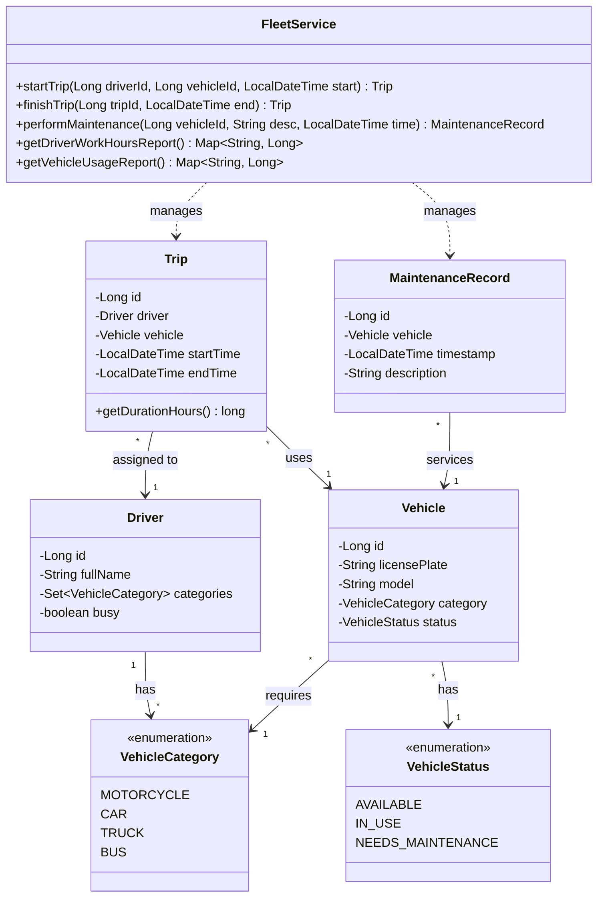

# Проект «Автопарк» (Вариант 4)

Готовый проект на **Java 17 + Spring Boot 3 + Spring Data JPA (Hibernate) + H2 Database**.

## Бизнес-требования
1. **Категории транспорта и допуск водителей:** В автопарке 4 вида ТС (`MOTORCYCLE`, `CAR`, `TRUCK`, `BUS`). Водитель допускается к рейсу только при наличии открытой категории прав на выбранное авто.
2. **Контроль занятости:** Один водитель не может находиться в двух рейсах одновременно; один автомобиль не может быть выдан двум водителям.
3. **Круглосуточные рейсы и дозаправка в пути (24/7):** Выезд и возврат из рейса возможны круглосуточно. Во время активного рейса (`IN_USE`) диспетчер/администратор может в любой момент внести в список работ путевую дозаправку или обслуживание на трассе без прерывания рейса.
4. **Обязательное послерейсовое ТО на базе:** После завершения рейса (`finishTrip`) автомобиль переводится в статус `NEEDS_MAINTENANCE` и не может выехать в следующий рейс до прохождения ТО на базе (работает в будние дни ПН–ПТ с 08:00 до 17:00).
5. **Аналитическая отчётность:** Формирование отчётов по суммарному рабочему времени каждого водителя (в часах) и по количеству поездок каждого автомобиля.

## Архитектура проекта
- `model` — Сущности БД (JPA Entities: `Driver`, `Vehicle`, `Trip`, `MaintenanceRecord`) и перечисления (`VehicleCategory`, `VehicleStatus`).
- `repository` — Слой доступа к данным (Spring Data JPA репозитории).
- `service` — Бизнес-логика (`FleetService`): проверка категорий, контроль одного авто на водителя, учет обязательного обслуживания после рейса в будни с 8:00 до 17:00, формирование отчетов.
- `FleetApplication` — Точка входа с демонстрационным сценарием (`CommandLineRunner`), который автоматически сохраняет данные в БД, проводит рейсы, ТО и выводит отчеты в консоль.
- `FleetServiceTest` — Набор модульных/интеграционных тестов JUnit 5.

## UML-диаграмма классов (Mermaid)



## Как запустить в VS Code или IntelliJ IDEA
1. Распакуйте архив и откройте папку `fleet-management-project` в IDE.
2. Запустите демонстрацию:
   ```bash
   mvn spring-boot:run
   ```
3. Или запустите автотесты:
   ```bash
   mvn test
   ```
