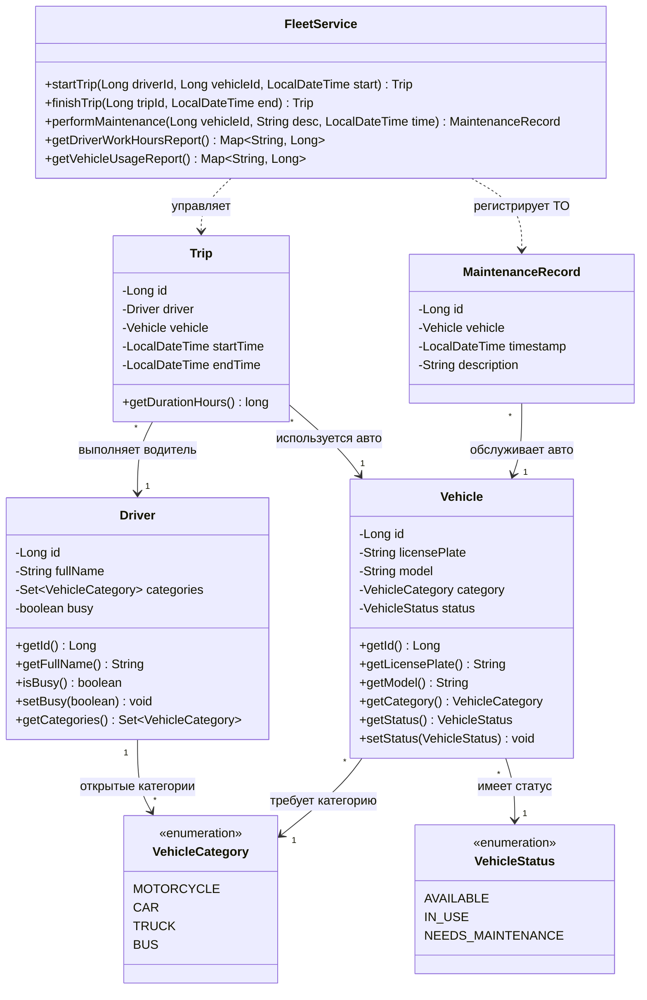
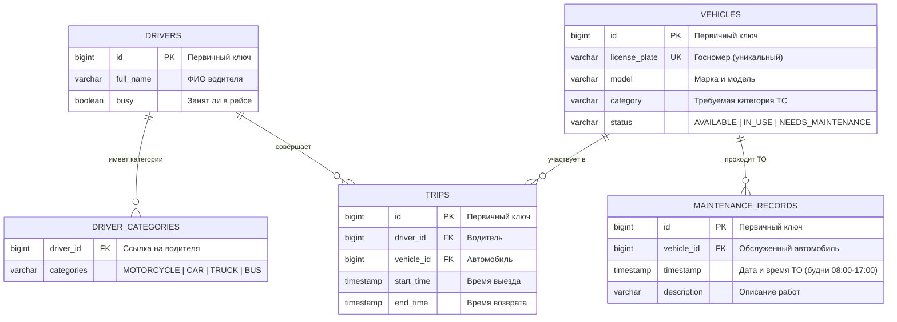
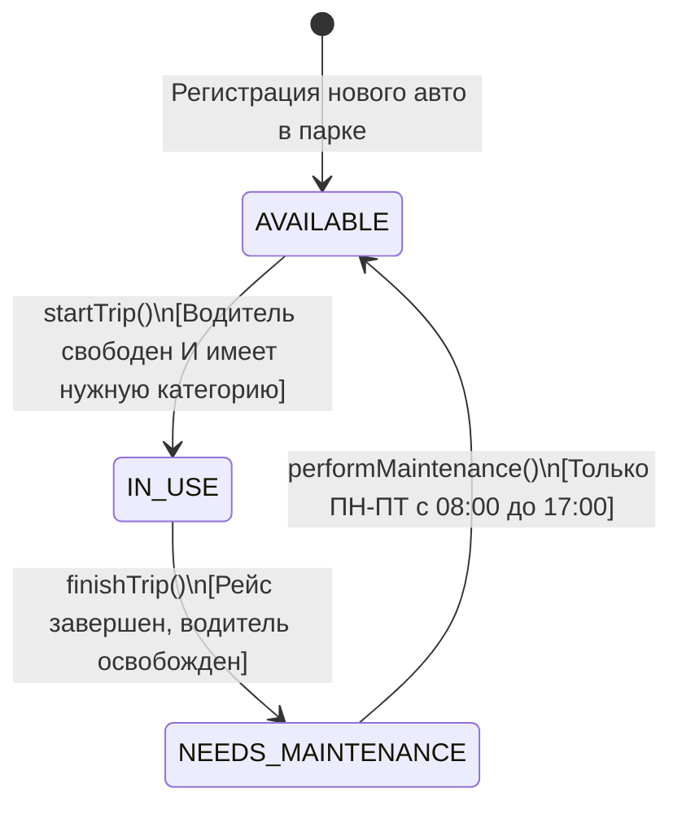
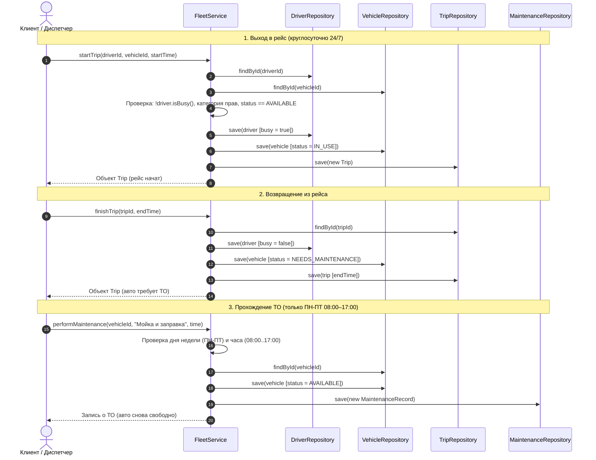
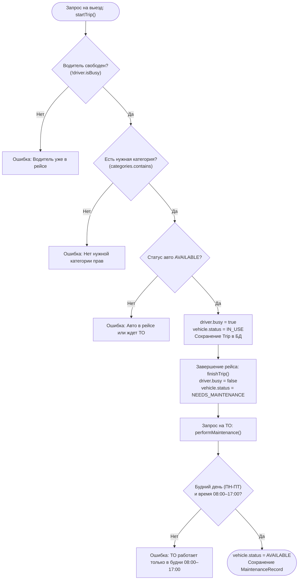

# UML и ER диаграммы проекта «Автопарк» (Вариант 4)

В этом документе собраны все диаграммы архитектуры, базы данных и бизнес-процессов системы.

---

## 1. Диаграмма классов (UML Class Diagram)
Отражает структуру Java-классов пакета `model` и `service`, их поля, методы и связи между ними.

---

## 2. ER-диаграмма базы данных (Entity-Relationship Diagram)
Показывает структуру таблиц в реляционной БД **H2**, первичные (`PK`) и внешние (`FK`) ключи, которые автоматически создаёт Hibernate.

---

## 3. Диаграмма состояний автомобиля (UML State Diagram)
Описывает жизненный цикл каждого автомобиля в автопарке и условия переходов между статусами.

---

## 4. Диаграмма последовательности (UML Sequence Diagram)
Показывает пошаговое взаимодействие компонентов при выезде в рейс, возврате и прохождении ТО.

---

## 5. Блок-схема алгоритма проверки выдачи авто и ТО (Flowchart)

